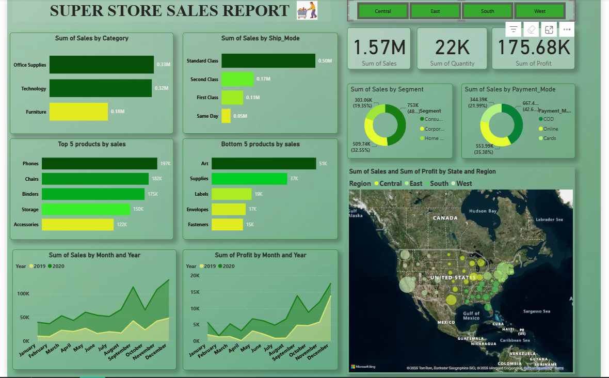

# Super Store Sales Analysis | Power BI Dashboard

## Project Overview

An interactive Business Intelligence project built using Power BI to analyze retail sales performance across products, customer segments, regions, and time periods.

The dashboard transforms historical sales data (2019–2020) into meaningful business insights, helping evaluate revenue, profitability, product performance, and regional sales trends.

## Dashboard Preview



## Business Objectives

- Monitor overall sales and profitability.
- Identify high-performing and low-performing products.
- Analyze sales across categories and sub-categories.
- Understand customer segment and payment mode distribution.
- Compare regional and state-wise sales performance.
- Track monthly and yearly sales trends.

## Key Performance Indicators

| KPI | Value |
|---|---:|
| Total Sales | 1,565,804.32 |
| Total Profit | 175,682.11 |
| Total Quantity Sold | 22,317 |
| Total Orders | 3,003 |
| Unique Customers | 773 |

## Dashboard Features

**1. Sales Performance**
- Overall sales and profit monitoring.
- Monthly and yearly performance trends.
- Sales and profit comparisons.

**2. Product Analysis**
- Category and sub-category performance.
- Top 5 and Bottom 5 products.
- Product-level sales and profitability analysis.

**3. Customer Analysis**
- Customer segment distribution.
- Payment mode analysis.

**4. Regional Analysis**
- State-wise sales and profit visualization.
- Regional performance comparison.
- Interactive regional filtering.

## Tools & Technologies

- **Power BI:** Dashboard development and data visualization.
- **Power Query:** Data preparation and transformation.
- **DAX:** KPI calculations and measures.
- **Microsoft Excel:** Source dataset.

## Dataset Information

- Source: Super Store Sales dataset.
- Period: January 2019 – December 2020.
- Records: 5,901.
- Unique Orders: 3,003.
- Unique Customers: 773.

The dataset includes order details, sales, profit, product categories, customer segments, geographical information, and payment modes.

## Skills Demonstrated

- Data preparation and transformation
- Data modeling and DAX
- KPI development
- Interactive dashboard design
- Sales and profitability analysis
- Business intelligence and data visualization

## Repository Structure

```text
Super-Store-Sales/
│
├── Dataset/
│   └── Super_Store_Sales.xlsx
│
├── PowerBI/
│   └── Super_store_sales.pbix
│
├── images/
│   └── Super_Store_Sales_Dashboard.png
│
└── README.md
```

## Project Outcome

Developed an interactive retail analytics dashboard that brings together sales, profitability, product, customer, and geographical performance in one reporting environment.

This project demonstrates the application of Power BI in converting raw business data into structured, interactive reports that support data-driven decision-making.
